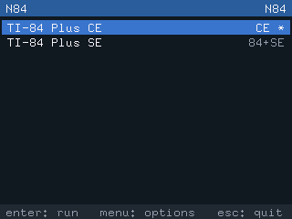
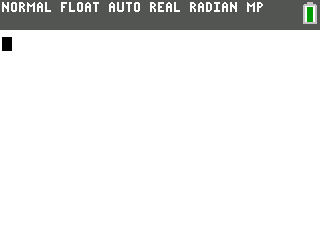
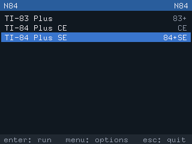
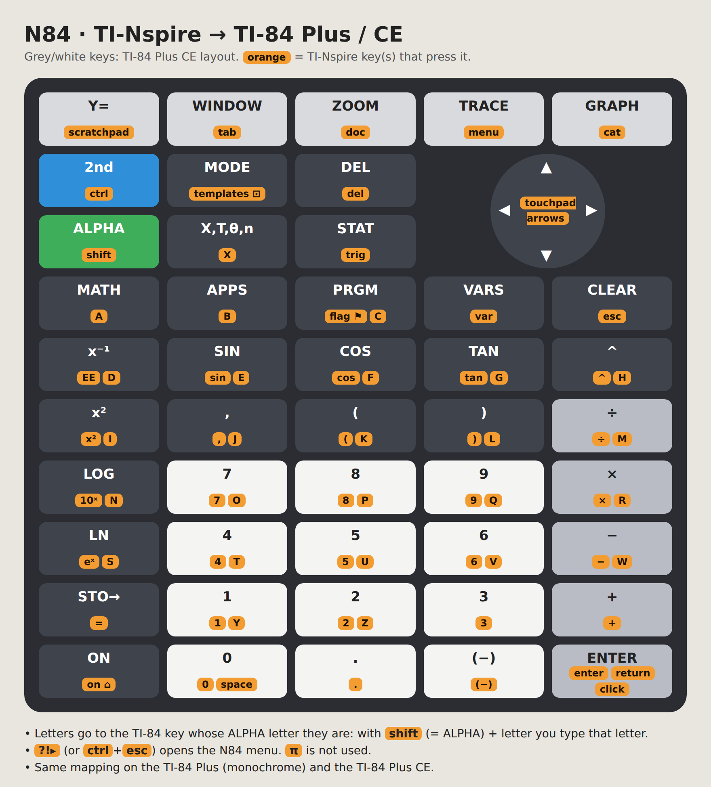

# N84

*[Read in English](README.md)*

Si tienes una TI-Nspire, quizá te suene esto: ves un juego o programa chulo en una calculadora y
quieres probarlo, pero resulta que es para las más populares TI-83/84 Plus o TI-84 Plus CE...

N84 quiere salvar esa distancia. Emula las calculadoras Z80 (TI-83/84 Plus) y eZ80
(TI-84 Plus CE) en tu **TI-Nspire CX II** (CAS, T), con [Ndless](https://ndless.me), para que
tengas lo mejor de ambos mundos. Ejecuta el TI-OS original a partir de una ROM de tu propia
calculadora.

<table>
  <tr>
    <td></td>
    <td></td>
    <td></td>
  </tr>
  <tr>
    <td></td>
    <td colspan="2" align="center"></td>
  </tr>
</table>

## Inicio rápido

1. Instala [Ndless](https://ndless.me) en tu TI-Nspire.
2. Copia `n84.tns` (de la página de [Releases](../../releases)) a la calculadora.
3. Copia tu ROM de TI-83/84 Plus o TI-84 Plus CE (obtenida legalmente) a la misma carpeta que
   `n84.tns`, con un nombre que termine en `.rom.tns`.
4. Abre `n84.tns`, elige la ROM y pulsa `enter`. `?!▸` abre el menú de N84.

Los pasos detallados están en [Instalación](#instalación).

## Estado alfa

El proyecto está en fase alfa, así que conviene saber algunas cosas:

- **Rendimiento:** lo he probado en mi TI-Nspire CX II. La TI-83/84 Plus va a velocidad completa,
  pero la TI-84 Plus CE puede ir algo lenta, sobre todo con programas exigentes. Supongo que en
  modelos de Nspire más antiguos irá peor (no se ha probado en la TI-Nspire CX I).
- **Compatibilidad:** solo tengo acceso legal a tres ROMs concretas, así que no sé si funcionan las
  ROMs con otras versiones del OS. Tampoco es seguro que todos los programas funcionen bien. Si
  encuentras un problema, [abre una incidencia](../../issues): cuenta qué hiciste, qué modelo de
  ROM y versión del OS usabas, y qué esperabas que pasara.

| Modelo emulado | Fichero ROM | Velocidad en una CX II real |
|---|---|---|
| TI-83 Plus | 512 KB | Velocidad completa (6 MHz) |
| TI-83 Plus SE, TI-84 Plus, TI-84 Plus SE | 1 o 2 MB | Velocidad completa (el núcleo llega a ~160 % de un Z80 a 15 MHz) |
| TI-84 Plus CE (modelos con Flash paralela: anteriores a la revisión de hardware M, boot < 5.3.6) | 4 MB | ~85–100 % de una CE real en juegos; las gráficas van más lentas (~75 %) |

Todavía no funcionan: las CE de la revisión M en adelante (Flash serie), las aplicaciones Flash de
la CE (`.8ek`) ni los cables USB o de enlace.

## Instalación

1. Instala [Ndless](https://ndless.me) en tu TI-Nspire CX II.
2. Descarga el último `n84-<versión>.zip` de la página de [Releases](../../releases) y
   descomprímelo.
3. Copia `n84.tns` a una carpeta de la calculadora (por ejemplo `N84`) con el software de
   TI-Nspire para PC o con TiLP. Si quieres, copia también `n84.keys.tns` (ver [Teclas](#teclas)).
4. Copia tu ROM a **la misma carpeta**, con un nombre que termine en `.rom.tns`:
   `ti84ce.rom` → `ti84ce.rom.tns`.

### Cómo conseguir la ROM

N84 no incluye software de TI ni puede descargarlo. Extrae la ROM de una calculadora tuya:

- **TI-84 Plus CE:** el asistente de ROM de [CEmu](https://ce-programming.github.io/CEmu/) crea
  un programa extractor para la calculadora y convierte lo que genera en un fichero `.rom`.
- **TI-84 Plus / SE, TI-83 Plus / SE:** usa [TiLP](http://lpg.ticalc.org/prj_tilp/) (*ROM dump*).

**N84 escribe los cambios de la memoria Archive dentro del propio fichero ROM**, así que guarda una
copia del volcado original en tu ordenador.

## Uso

Abre `n84.tns`. El **lanzador** muestra las ROMs de su carpeta con su modelo; `*` indica que hay
un estado guardado.

- `enter` ejecuta la ROM seleccionada, `menu` abre sus opciones (información, transferir ficheros,
  borrar el estado guardado, guía de teclas, ajustes), `esc` sale.

Con la calculadora en marcha, **`?!▸` (o `ctrl`+`esc`) abre el menú de N84**: continuar, enviar
ficheros, guardar/cargar estado, guía de teclas, resetear, turbo, indicador de velocidad,
frameskip, volver al lanzador y salir.

- **Estado guardado:** al salir, el estado de la calculadora se guarda en `NOMBRE.sav.tns` y se
  recupera la próxima vez, así que sigues donde lo dejaste.
- **Enviar programas:** copia los ficheros (`.8xp`, `.8xv`, `.8xg`, `.8xk`…) a la calculadora con
  `.tns` al final (`JUEGO.8xp.tns`). Después usa *Send file…* en el menú de N84, o *Transfer
  files…* en las opciones de la ROM en el lanzador. Las variables marcadas como archivadas van a la
  Archive. Para crear las variables, la calculadora emulada pasa un momento por la pantalla MODE y
  vuelve a la pantalla principal. Se pierde lo que estuviera a medio escribir.
- **Velocidad:** *Show speed* muestra en una esquina los FPS y la velocidad de la emulación.
  *Frameskip* (automático por defecto) se salta el dibujado de algunos fotogramas para que la
  calculadora emulada vaya a velocidad completa. *Turbo* va lo más rápido posible.

Los ajustes globales se guardan en `n84.cfg.tns`.

> **Consejo:** la TI-Nspire baja la velocidad de su CPU mientras está conectada por USB.
> Desconecta el cable antes de valorar la velocidad.

## Teclas



La imagen muestra el mapa por defecto, y la *Key guide* del menú de N84 lo muestra en la
calculadora. En resumen:

- Las teclas con el mismo nombre se corresponden (números, flechas, operaciones, `sin`, `del`,
  `enter`…).
- `ctrl` = 2ND, `shift` = ALPHA, `esc` = CLEAR, `home/on` = ON.
- La fila superior, `scratchpad` `tab` `doc` `menu` `cat`, corresponde a Y= WINDOW ZOOM TRACE
  GRAPH.
- Cada letra pulsa la tecla de la TI-84 cuya función ALPHA es esa letra, así que `shift` + letra la
  escribe.

Para cambiar el mapa, edita `n84.keys.tns` en el ordenador y cópialo junto a `n84.tns`. Es un
fichero de texto con un par `tecla_nspire  tecla_ti84` por línea. Las teclas que no aparecen
conservan su valor por defecto, y `none` desactiva una tecla:

```
# intercambiar 2ND y ALPHA, usar la tecla flag como MODE
ctrl   ALPHA
shift  2ND
flag   MODE
```

El fichero que viene con la versión contiene todo el mapa por defecto y los nombres que se aceptan.
Si una línea está mal, N84 dice cuál al arrancar. `?!▸` no se puede reasignar.

## Compilar

Requisitos:

- Un sistema Linux (o WSL) con `gcc` y `make`, para las versiones de PC y los tests.
- El [SDK de Ndless](https://github.com/ndless-nspire/Ndless), para la versión de la calculadora.

```sh
make host              # versiones de PC: tests, emuladores sin pantalla, n84-ui
make test              # tests de CPU y de máquina (ZEXDOC, eZ80, test diferencial, ROM sintética de TI-84)
make test-full         # además ZEXALL (~40 s)
make rom-smoke         # con tus ROMs en roms/ (ti84se.rom, ti83plus.rom, ti84ce.rom): arranque, cálculo, gráfica, recorrido de la interfaz
export PATH=$HOME/Ndless/ndless-sdk/bin:$PATH
make nspire            # build/nspire/n84.tns y n84bench.tns
make dist              # zip de la versión en build/dist/
```

Un `local.mk` opcional (no se sube al repositorio) puede definir `DEPLOY_DIR`. Cada `.tns`
recompilado se copia ahí.

En el zip de la versión, `benchmark/n84bench.tns` mide la velocidad de la calculadora y de los
núcleos de CPU y escribe `n84bench.txt.tns`. No hace falta para usar N84, pero ese fichero ayuda
si informas de un problema de velocidad.

Las herramientas de PC, la estructura del código y los créditos están en el
[README en inglés](README.md#pc-tools).

## Licencia y créditos

N84 está hecho por [FerdinandoPH](https://github.com/FerdinandoPH) y es software libre bajo la [GNU GPL v3](LICENSE) o posterior.

Gracias a la gente que hay detrás de:

- El [SDK de Ndless](https://github.com/ndless-nspire/Ndless), con el que se compila la versión
  de la calculadora.
- nspire-z80, el emulador anterior de TI-83/84 Plus para la TI-Nspire.
- [CEmu](https://github.com/CE-Programming/CEmu), del que están adaptados los periféricos de la
  TI-84 Plus CE (GPLv3; detalles en `src/machine/ce/README.md`). El núcleo eZ80 de N84 sigue el
  comportamiento de las instrucciones del núcleo de CPU de CEmu.
- [TilEm](https://lpg.ticalc.org/prj_tilem/) y [WikiTI](https://wikiti.brandonw.net), las
  referencias para el hardware de la TI-83 Plus / TI-84 Plus.

TI-84 Plus, TI-84 Plus CE, TI-83 Plus y TI-Nspire son marcas de Texas Instruments. N84 no tiene
relación con Texas Instruments.
