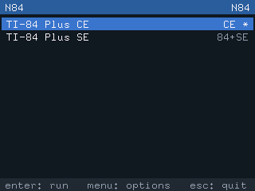
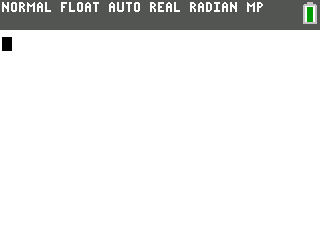
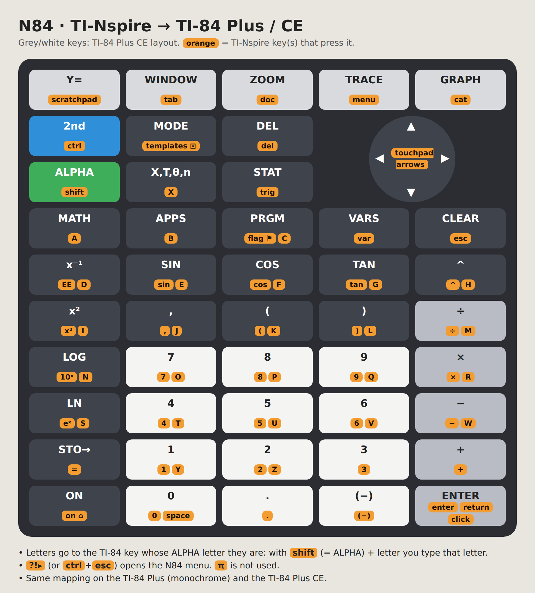

# N84

*[Leer en español](README.es.md)*

If you have a TI-Nspire, this feeling may be familiar: you see a cool game or program running on a
calculator and you want to try it, only to find out it's for the more popular TI-83/84 Plus or
TI-84 Plus CE series...

N84 intends to bridge that gap. It emulates both the Z80 (TI-83/84 Plus) and the eZ80
(TI-84 Plus CE) calculators on your **TI-Nspire CX II** (CAS, T), under [Ndless](https://ndless.me),
so you get the best of both worlds. It runs the real TI-OS from a ROM image of your own calculator.

<table>
  <tr>
    <td></td>
    <td></td>
    <td></td>
  </tr>
  <tr>
    <td align="center">Launcher, home screen and menu</td>
    <td align="center">Graphing on the TI-84 Plus CE</td>
    <td align="center">A game (Geometry Dash CE)</td>
  </tr>
</table>

## Quick start

1. Install [Ndless](https://ndless.me) on your TI-Nspire.
2. Copy `n84.tns` (from the [Releases](../../releases) page) to the calculator.
3. Copy your (legally obtained) TI-83/84 Plus or TI-84 Plus CE ROM file to the same folder as
   `n84.tns`, renamed to end in `.rom.tns`.
4. Open `n84.tns`, pick the ROM and press `enter`. `?!▸` opens the N84 menu.

Step-by-step details are in [Installing](#installing) below.

## Alpha status

This project is in an alpha state, so there are a few things you need to know:

- **Performance:** I used my TI-Nspire CX II. The TI-83/84 Plus runs at full speed, but the
  TI-84 Plus CE can lag a bit, especially with demanding programs. I expect it to be worse on older
  Nspire models (the TI-Nspire CX, not II, has not been tested).
- **Compatibility:** I only have legal access to three particular ROMs, so I'm not sure whether ROMs
  with other OS versions work. Likewise, not every program may run correctly. If you find a
  problem, please [open an issue](../../issues), and include what you did, which ROM model and OS version
  you used, and what you expected.

| Emulated model                                                                       | ROM file  | Speed on a real CX II                                      |
| ------------------------------------------------------------------------------------ | --------- | ---------------------------------------------------------- |
| TI-83 Plus                                                                           | 512 KB    | Full speed                                                 |
| TI-83 Plus SE, TI-84 Plus, TI-84 Plus SE                                             | 1 or 2 MB | Full speed                                                 |
| TI-84 Plus CE (parallel-Flash models: before hardware revision M, boot code < 5.3.6) | 4 MB      | ~85–100% of a real CE in games; graphing is slower (~75%) |

Not supported yet: CE revision M and later (serial Flash), CE Flash applications (`.8ek`) and
USB/link cables.

## Installing

1. Install [Ndless](https://ndless.me) on your TI-Nspire CX II.
2. Download the latest `n84-<version>.zip` from the
   [Releases](../../releases) page and unzip it.
3. Copy `n84.tns` to a folder of the calculator (for example `N84`) with the TI-Nspire computer
   software or TiLP. Optionally copy `n84.keys.tns` too (see [Keys](#keys)).
4. Copy your (legally obtained) ROM image to **the same folder**, renamed to end in `.rom.tns`:
   `ti84ce.rom` → `ti84ce.rom.tns`.

### Getting a ROM

N84 does not include any TI software and cannot download it. Dump the ROM from a calculator you
own:

- **TI-84 Plus CE:** [CEmu](https://ce-programming.github.io/CEmu/)'s ROM wizard creates a dumper
  program for the calculator and turns its output into a `.rom` file.
- **TI-84 Plus / SE, TI-83 Plus / SE:** use [TiLP](http://lpg.ticalc.org/prj_tilp/) (*ROM dump*).

**N84 writes changes to the Archive memory into the ROM file itself**, so keep a copy of the
original dump on your computer.

## Using N84

Open `n84.tns`. The **launcher** lists the ROMs in its folder with their model; `*` means there is
a saved state.

- `enter` runs the highlighted ROM, `menu` opens its options (information, transfer files, delete
  saved state, key guide, settings), `esc` quits.

While the calculator runs, **`?!▸` (or `ctrl`+`esc`) opens the N84 menu**: resume, send files,
save/load state, key guide, reset, turbo, speed indicator, frameskip, back to the launcher, quit.

- **Saved state:** the calculator's state is saved in `NAME.sav.tns` when you leave and restored
  the next time, so you continue where you left off.
- **Sending programs:** copy the files (`.8xp`, `.8xv`, `.8xg`, `.8xk`…) to the calculator with
  `.tns` appended (`GAME.8xp.tns`). Then use *Send file…* in the N84 menu, or *Transfer files…* in
  the ROM options of the launcher. Variables marked as archived go to the Archive. To create the
  variables, the emulated calculator briefly visits the MODE screen and returns to the home
  screen. Anything half-typed there is lost.
- **Speed:** *Show speed* displays the frame rate and the emulation speed in the corner.
  *Frameskip* (auto by default) skips drawing frames to keep the emulated calculator at full speed.
  *Turbo* runs as fast as possible.

Global settings are stored in `n84.cfg.tns`.

> **Tip:** the TI-Nspire slows its CPU down while it is connected by USB. Unplug the cable before
> judging the speed.

## Keys



The picture shows the default map, and the *Key guide* in the N84 menu lists it on the
calculator. In short:

- Keys with the same name map directly (digits, arrows, operators, `sin`, `del`, `enter`, …).
- `ctrl` = 2ND, `shift` = ALPHA, `esc` = CLEAR, `home/on` = ON.
- The top row `scratchpad` `tab` `doc` `menu` `cat` = Y= WINDOW ZOOM TRACE GRAPH.
- Each letter key presses the TI-84 key whose ALPHA function is that letter, so `shift`+letter types
  it.

To change the map, edit `n84.keys.tns` on your computer and copy it next to `n84.tns`. It is a
plain text file with one `nspire_key  ti84_key` pair per line. Keys that are not listed keep their
default, and `none` disables a key:

```
# swap 2ND and ALPHA, use the flag key for MODE
ctrl   ALPHA
shift  2ND
flag   MODE
```

The file shipped with the release lists every default with the accepted names. If a line is wrong,
N84 says which one when it starts. `?!▸` cannot be remapped.

## Building from source

Requirements:

- A Linux (or WSL) system with `gcc` and `make` for the PC builds and tests.
- The [Ndless SDK](https://github.com/ndless-nspire/Ndless) for the calculator build.

```sh
make host              # PC builds: test runners, headless emulators, n84-ui
make test              # CPU and machine tests (ZEXDOC, eZ80, differential test, synthetic TI-84 ROM)
make test-full         # also ZEXALL (~40 s)
make rom-smoke         # needs your ROMs in roms/ (ti84se.rom, ti83plus.rom, ti84ce.rom): boot, math, graph, UI walk
export PATH=$HOME/Ndless/ndless-sdk/bin:$PATH
make nspire            # build/nspire/n84.tns and n84bench.tns
make dist              # release zip in build/dist/
```

An optional, uncommitted `local.mk` can set `DEPLOY_DIR`, and every `.tns` that is rebuilt is
copied there.

### PC tools

- `build/host/n84-host ROM SECONDS [-o shot.ppm] [-s STATE] [-l STATE] [-t] [T:KEY ...]` runs a
  TI-84 Plus ROM headless for that many emulated seconds. Events like `5.0:ENTER` or
  `6.0:shot=step.ppm` press a key or save a screenshot at that time, `-s`/`-l` save and load a
  state, and `-t` prints timing information.
- `build/host/n84ce-host` is the same for the TI-84 Plus CE.
- `build/host/n84-ui` runs the real calculator frontend with a script (see
  `src/platform/host/plat_host.c` and `tests/ui/smoke.sh`).
- `n84bench.tns` (in the `benchmark` folder of the release zip) measures the platform and both CPU cores on the calculator
  and writes `n84bench.txt.tns`. It is useful when reporting performance problems.

### Layout

| Path                              | Contents                                                                               |
| --------------------------------- | -------------------------------------------------------------------------------------- |
| `src/cpu/z80`, `src/cpu/ez80` | CPU cores. The eZ80 one has a per-mode fast path (`ez80_fast.inc`, `ez80_run.inc`) |
| `src/machine/ti8x`              | TI-83 Plus (SE) / TI-84 Plus (SE) hardware                                             |
| `src/machine/ce`                | TI-84 Plus CE hardware, mostly adapted from CEmu (see its `README.md`)               |
| `src/link`                      | `.8x?` file parsing                                                                  |
| `src/frontend`                  | Launcher, session, menus, key map, benchmark, PC drivers                               |
| `src/platform`                  | Ndless and PC platform layers (`platform.h`)                                         |
| `tests`                         | Test programs and the UI smoke test                                                    |
| `tools`                         | Font generator, test ROM and `.8xp` builders, ROM smoke test                         |

## License and credits

N84 is made by [FerdinandoPH](https://github.com/FerdinandoPH) and is free software under the [GNU GPL v3](LICENSE) or later.

Credits to the people behind:

- The [Ndless SDK](https://github.com/ndless-nspire/Ndless), which the calculator build uses.
- nspire-z80, the earlier TI-83/84 Plus emulator for the TI-Nspire.
- [CEmu](https://github.com/CE-Programming/CEmu), which the TI-84 Plus CE peripherals are adapted
  from (GPLv3; details in `src/machine/ce/README.md`).

The UI font is Lat15-Fixed13 from the Linux console fonts. TI-84 Plus, TI-84 Plus CE, TI-83 Plus and
TI-Nspire are trademarks of Texas Instruments. N84 is not affiliated with Texas Instruments.
